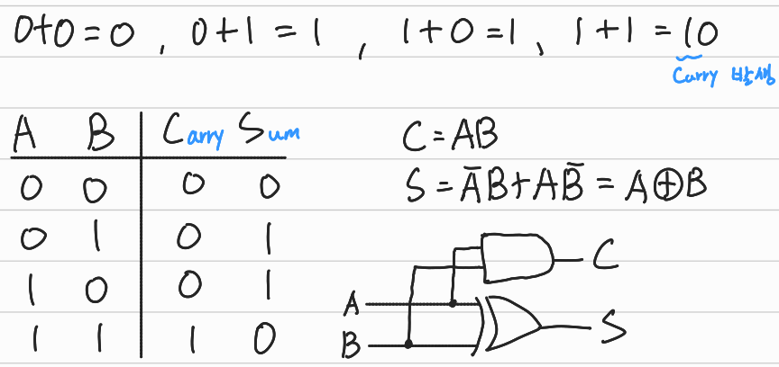
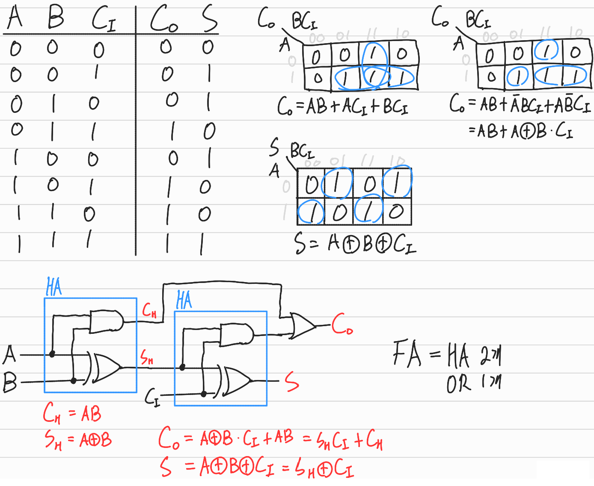

# Adder (Half Adder / Full Adder)
Verilog HDL로 Half Adder와 Full Adder를 설계하고, Full Adder를 서로 다른 두 방식으로 구현해 비교했습니다.

이 모듈들은 이후 "4-bit / 8-bit Ripple Carry Adder"의 기본 블록으로 사용됩니다.

## 📁 Files
| File | Description | Modeling |
|---|---|---|
| `Half_Adder.v` | Half Adder + Testbench | Dataflow |
| `Full_Adderc.v` | Full Adder + Testbench | Dataflow (논리식) |
| `Full_Adder_2HA.v` | Half Adder 2개 + OR로 구성한 Full Adder | Structural |

## 1. Half Adder
1-bit 두 수를 더해 Sum(S)과 Carry(C)를 출력합니다. (1 + 1 = 10 → Carry 발생)

| A | B | C | S |
|:-:|:-:|:-:|:-:|
| 0 | 0 | 0 | 0 |
| 0 | 1 | 0 | 1 |
| 1 | 0 | 0 | 1 |
| 1 | 1 | 1 | 0 |

- `C = A · B`
- `S = A ⊕ B`



## 2. Full Adder
Carry-in(CI)까지 포함해 3개의 1-bit 입력을 더합니다.

| A | B | CI | CO | S |
|:-:|:-:|:-:|:-:|:-:|
| 0 | 0 | 0 | 0 | 0 |
| 0 | 0 | 1 | 0 | 1 |
| 0 | 1 | 0 | 0 | 1 |
| 0 | 1 | 1 | 1 | 0 |
| 1 | 0 | 0 | 0 | 1 |
| 1 | 0 | 1 | 1 | 0 |
| 1 | 1 | 0 | 1 | 0 |
| 1 | 1 | 1 | 1 | 1 |

K-map 간소화 결과:
- `CO = AB + A·CI + B·CI = AB + (A ⊕ B)·CI`
- `S = A ⊕ B ⊕ CI`



### 구현 방식 비교
**(a) Dataflow** — `Full_Adderc.v`
```verilog
assign CO = ((A ^ B) & CI) | (A & B);
assign S  = A ^ B ^ CI;
```

**(b) Structural (HA 2개 + OR)** — `Full_Adder_2HA.v`

`FA = HA 2개 + OR 1개`

- HA1: `CH1 = A·B`, `SH = A ⊕ B`
- HA2: `CH2 = SH·CI`, `S = SH ⊕ CI`
- `CO = CH1 | CH2`

두 방식은 논리적으로 동일하며, (b)는 하위 모듈을 재사용하는 계층 설계의 기초가 됩니다.

## ✅ Key Learning
- 진리표 → K-map → 논리식 → Verilog로 이어지는 설계 흐름
- `CO = AB + (A ⊕ B)·CI` 형태로 정리하면 HA 재사용이 가능함을 확인
- Dataflow vs Structural 모델링 차이

## 🛠 Development Environment
- Verilog HDL / Antigravity IDE (VS Code)