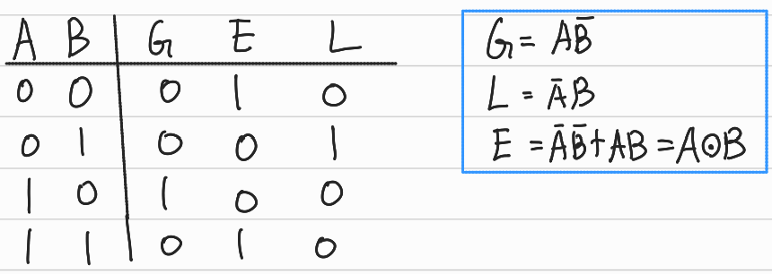
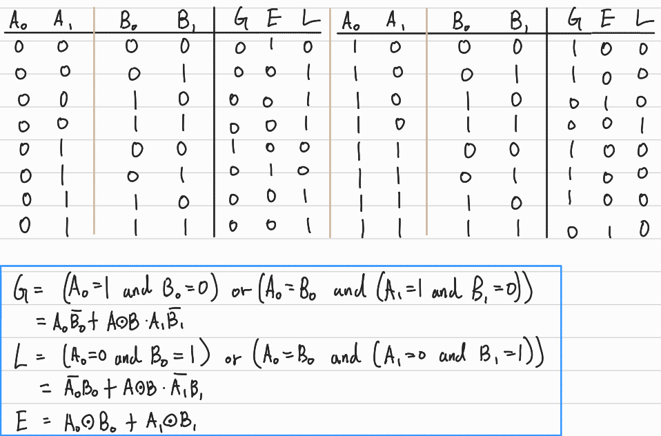

# Comparator (1-bit / 2-bit)
Verilog HDL로 1-bit, 2-bit Comparator를 설계하고, 2-bit Comparator를 개별 비트 포트 방식과 벡터 포트 방식으로 구현해 비교했습니다.

두 입력 A, B의 크기를 비교하여 Greater(G), Equal(E), Less(L) 중 하나만 1이 되도록 출력합니다.

## 📁 Files
| File | Description | Modeling |
|---|---|---|
| `1bit_Comparator.v` | 1-bit Comparator + Testbench | Dataflow |
| `2bit_Comparator.v` | 2-bit Comparator + Testbench (개별 비트 포트) | Dataflow |
| `2bit_Comparator_for.v` | 2-bit Comparator + Testbench (벡터 포트, `for`문 전수 검사) | Dataflow |

## 1. 1-bit Comparator
| A | B | G (A>B) | E (A=B) | L (A<B) |
|:-:|:-:|:-:|:-:|:-:|
| 0 | 0 | 0 | 1 | 0 |
| 0 | 1 | 0 | 0 | 1 |
| 1 | 0 | 1 | 0 | 0 |
| 1 | 1 | 0 | 1 | 0 |

- `G = A · B̄`
- `L = Ā · B`
- `E = ĀB̄ + AB = A ⊙ B`



## 2. 2-bit Comparator
`A0`, `B0`이 **상위 비트(MSB)**, `A1`, `B1`이 **하위 비트(LSB)** 입니다.
(A = A0A1, B = B0B1)

| A0 | A1 | B0 | B1 | A | B | G | E | L |
|:-:|:-:|:-:|:-:|:-:|:-:|:-:|:-:|:-:|
| 0 | 0 | 0 | 0 | 0 | 0 | 0 | 1 | 0 |
| 0 | 0 | 0 | 1 | 0 | 1 | 0 | 0 | 1 |
| 0 | 0 | 1 | 0 | 0 | 2 | 0 | 0 | 1 |
| 0 | 0 | 1 | 1 | 0 | 3 | 0 | 0 | 1 |
| 0 | 1 | 0 | 0 | 1 | 0 | 1 | 0 | 0 |
| 0 | 1 | 0 | 1 | 1 | 1 | 0 | 1 | 0 |
| 0 | 1 | 1 | 0 | 1 | 2 | 0 | 0 | 1 |
| 0 | 1 | 1 | 1 | 1 | 3 | 0 | 0 | 1 |
| 1 | 0 | 0 | 0 | 2 | 0 | 1 | 0 | 0 |
| 1 | 0 | 0 | 1 | 2 | 1 | 1 | 0 | 0 |
| 1 | 0 | 1 | 0 | 2 | 2 | 0 | 1 | 0 |
| 1 | 0 | 1 | 1 | 2 | 3 | 0 | 0 | 1 |
| 1 | 1 | 0 | 0 | 3 | 0 | 1 | 0 | 0 |
| 1 | 1 | 0 | 1 | 3 | 1 | 1 | 0 | 0 |
| 1 | 1 | 1 | 0 | 3 | 2 | 1 | 0 | 0 |
| 1 | 1 | 1 | 1 | 3 | 3 | 0 | 1 | 0 |

**비교 방식**: 상위 비트를 먼저 비교하고, 상위 비트가 같을 때만 하위 비트를 비교합니다.

- `G = A0·B̄0 + (A0 ⊙ B0)·A1·B̄1`
- `L = Ā0·B0 + (A0 ⊙ B0)·Ā1·B1`
- `E = (A0 ⊙ B0)·(A1 ⊙ B1)`



### 구현 방식 비교
**(a) 개별 비트 포트** — `2bit_Comparator.v`
```verilog
assign G = (A0 & ~B0) | (~(A0 ^ B0) & (A1 & ~B1));
assign L = (~A0 & B0) | (~(A0 ^ B0) & (~A1 & B1));
assign E = ~(A0 ^ B0) & ~(A1 ^ B1);
```

**(b) 벡터 포트 + `for`문 테스트벤치** — `2bit_Comparator_for.v`
```verilog
input [1:0] A, B;   // A[1] = MSB, A[0] = LSB
assign G = (A[1] & ~B[1]) | (~(A[1] ^ B[1]) & (A[0] & ~B[0]));
```
- 논리식은 (a)와 동일하며, 비트 번호만 `A0→A[1]`, `A1→A[0]`으로 대응됩니다.
- 이중 `for`문으로 A, B의 16가지 조합을 전수 검사합니다.
- 입력 폭이 커질수록 (a)는 포트가 늘어나지만 (b)는 `[N-1:0]`만 바꾸면 되어 확장에 유리합니다.

## ✅ Key Learning
- G, E, L은 항상 **하나만 1**이 되는 상호 배타적 출력 구조
- XNOR(`⊙`)로 "같은지"를 판별하고, 상위 비트 우선 비교 구조를 논리식으로 구현
- 2-bit 구조를 확장하면 n-bit Comparator로 일반화 가능
- 개별 비트 포트 vs 벡터 포트, 수동 입력 TB vs `for`문 전수 검사 TB 비교

## 🛠 Development Environment
- Verilog HDL / Antigravity IDE (VS Code)