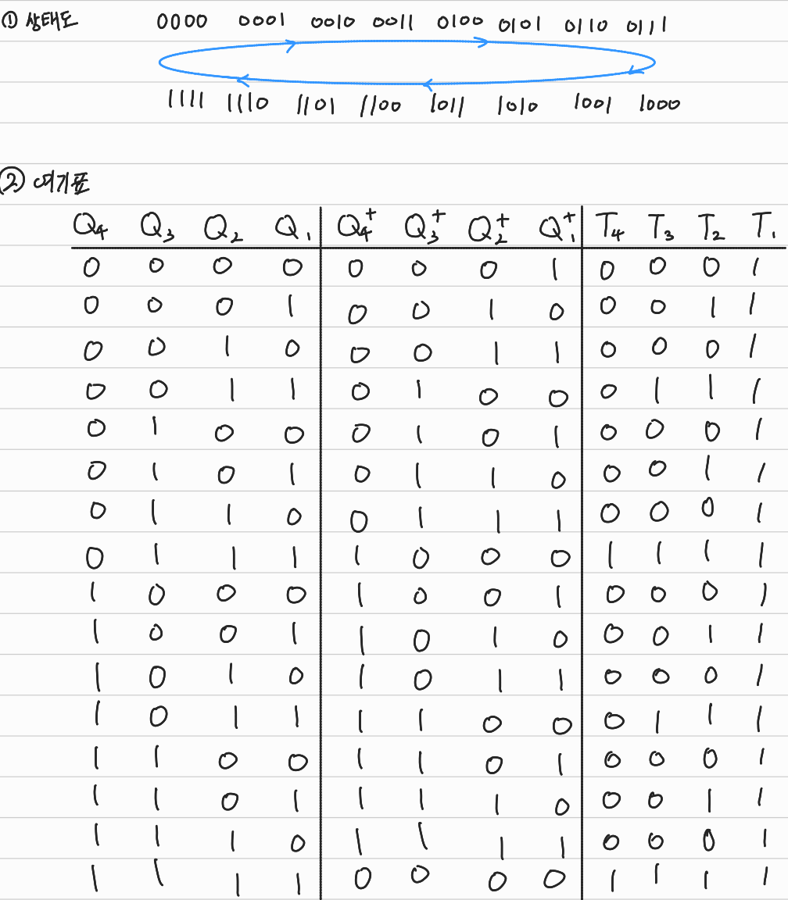
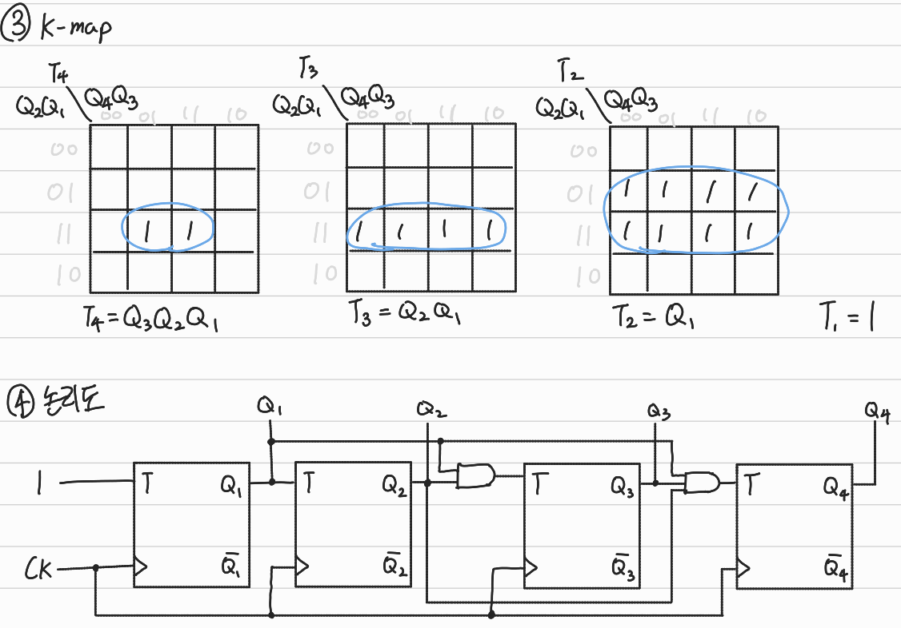

# 4-bit Up Counter
Verilog HDL로 4-bit Up Counter를 설계하고, 같은 동작을 두 가지 방식으로 구현해 비교했습니다.

클럭 상승 에지마다 0000 → 1111까지 1씩 증가하고, 1111 다음에는 0000으로 돌아가는(overflow) 동기식 카운터입니다.

## 📁 Files
| File | Description | Modeling |
|---|---|---|
| `4bit_Up_Counter_Behavioral.v` | `Q <= Q + 1` 로 구현 + Testbench | Behavioral |
| `4bit_Up_Counter_Structural.v` | T Flip-Flop 4개 + AND 게이트로 구현 + Testbench | Structural |

## 1. 상태도
16개 상태가 하나의 순환 구조를 이루며, 클럭 에지마다 다음 상태로 이동합니다.

```text
0000 → 0001 → 0010 → 0011 → 0100 → 0101 → 0110 → 0111
  ↑                                                  ↓
1111 ← 1110 ← 1101 ← 1100 ← 1011 ← 1010 ← 1001 ← 1000
```

## 2. T Flip-Flop 기반 설계
T Flip-Flop은 T = 0이면 Hold, T = 1이면 Toggle 합니다.
상태 천이에 필요한 T 입력은 `T = Q ⊕ Q⁺` 로 구합니다. (Q⁺ : 다음 상태)

### 여기표
(Q4가 MSB, Q1이 LSB)

| Q4 | Q3 | Q2 | Q1 | Q4⁺ | Q3⁺ | Q2⁺ | Q1⁺ | T4 | T3 | T2 | T1 |
|:-:|:-:|:-:|:-:|:-:|:-:|:-:|:-:|:-:|:-:|:-:|:-:|
| 0 | 0 | 0 | 0 | 0 | 0 | 0 | 1 | 0 | 0 | 0 | 1 |
| 0 | 0 | 0 | 1 | 0 | 0 | 1 | 0 | 0 | 0 | 1 | 1 |
| 0 | 0 | 1 | 0 | 0 | 0 | 1 | 1 | 0 | 0 | 0 | 1 |
| 0 | 0 | 1 | 1 | 0 | 1 | 0 | 0 | 0 | 1 | 1 | 1 |
| 0 | 1 | 0 | 0 | 0 | 1 | 0 | 1 | 0 | 0 | 0 | 1 |
| 0 | 1 | 0 | 1 | 0 | 1 | 1 | 0 | 0 | 0 | 1 | 1 |
| 0 | 1 | 1 | 0 | 0 | 1 | 1 | 1 | 0 | 0 | 0 | 1 |
| 0 | 1 | 1 | 1 | 1 | 0 | 0 | 0 | 1 | 1 | 1 | 1 |
| 1 | 0 | 0 | 0 | 1 | 0 | 0 | 1 | 0 | 0 | 0 | 1 |
| 1 | 0 | 0 | 1 | 1 | 0 | 1 | 0 | 0 | 0 | 1 | 1 |
| 1 | 0 | 1 | 0 | 1 | 0 | 1 | 1 | 0 | 0 | 0 | 1 |
| 1 | 0 | 1 | 1 | 1 | 1 | 0 | 0 | 0 | 1 | 1 | 1 |
| 1 | 1 | 0 | 0 | 1 | 1 | 0 | 1 | 0 | 0 | 0 | 1 |
| 1 | 1 | 0 | 1 | 1 | 1 | 1 | 0 | 0 | 0 | 1 | 1 |
| 1 | 1 | 1 | 0 | 1 | 1 | 1 | 1 | 0 | 0 | 0 | 1 |
| 1 | 1 | 1 | 1 | 0 | 0 | 0 | 0 | 1 | 1 | 1 | 1 |

### K-map 간소화 결과
- `T1 = 1`
- `T2 = Q1`
- `T3 = Q2 · Q1`
- `T4 = Q3 · Q2 · Q1`

해당 비트는 **하위 비트가 모두 1일 때만** Toggle 합니다. (자리올림이 발생하는 조건과 같음)

### 논리도



모든 Flip-Flop이 같은 클럭(CK)을 공유하는 **동기식(Synchronous) 카운터**입니다.

## 3. 구현 방식 비교
**(a) Behavioral** — `4bit_Up_Counter_Behavioral.v`
```verilog
always @(posedge CK) begin
    Q <= Q + 1;
end
```

**(b) Structural (T-FF + AND)** — `4bit_Up_Counter_Structural.v`
```verilog
assign T0 = 1'b1;
assign T1 = q0;
assign T2 = q1 & q0;
assign T3 = q2 & q1 & q0;
```
- 손글씨 `Q1~Q4`와 코드 `q0~q3`의 대응: `Q1=q0`, `Q2=q1`, `Q3=q2`, `Q4=q3`
- `T_FF`는 `Q <= T ? ~Q : Q;` 로 Hold/Toggle을 구현

두 방식은 동일하게 동작하며, (a)는 간결하고 (b)는 카운터가 내부적으로 어떻게 동작하는지 보여줍니다.

## ✅ Key Learning
- 상태도 → 여기표 → K-map → 논리도로 이어지는 순차회로 설계 흐름
- T Flip-Flop 여기표(`T = Q ⊕ Q⁺`)를 이용한 입력 유도
- 하위 비트가 모두 1일 때 상위 비트가 Toggle 하는 구조 (Carry 전파와 동일한 개념)
- Behavioral vs Structural 모델링 차이, 비차단 할당(`<=`)을 이용한 순차회로 작성
- 동기식 카운터의 특성

## 🛠 Development Environment
- Verilog HDL / Antigravity IDE (VS Code)