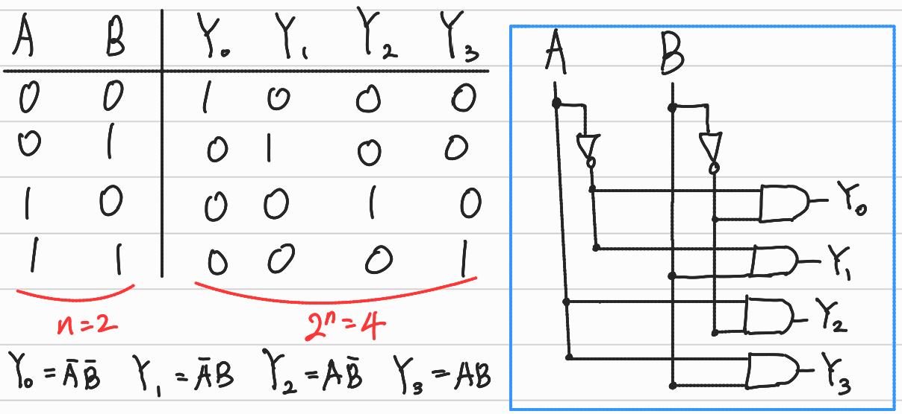
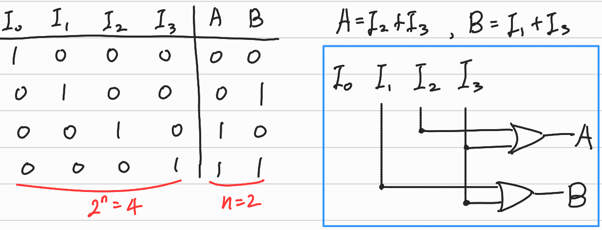

# Decoder / Encoder
Verilog HDL로 2-to-4 Decoder와 4-to-2 Encoder를 설계했습니다.

Decoder는 n-bit 입력을 2ⁿ개의 출력 중 하나로 변환하고, Encoder는 반대로 2ⁿ개의 입력 중 활성화된 하나를 n-bit 코드로 변환합니다.

## 📁 Files
| File | Description | Modeling |
|---|---|---|
| `Decoder.v` | 2-to-4 Decoder + Testbench | Dataflow |
| `Encoder.v` | 4-to-2 Encoder + Testbench | Dataflow |

## 1. Decoder (2-to-4)
2-bit 입력(n = 2)을 받아 4개(2ⁿ) 출력 중 **하나만 1**로 만듭니다.
(코드 포트 대응: `A = IN0`(MSB), `B = IN1`(LSB), `Y0~Y3 = OUT0~OUT3`)

| A | B | Y0 | Y1 | Y2 | Y3 |
|:-:|:-:|:-:|:-:|:-:|:-:|
| 0 | 0 | 1 | 0 | 0 | 0 |
| 0 | 1 | 0 | 1 | 0 | 0 |
| 1 | 0 | 0 | 0 | 1 | 0 |
| 1 | 1 | 0 | 0 | 0 | 1 |

- `Y0 = Ā · B̄`
- `Y1 = Ā · B`
- `Y2 = A · B̄`
- `Y3 = A · B`

각 출력은 입력 조합의 **최소항(minterm)** 하나에 해당하며, 인버터와 AND 게이트만으로 구성됩니다.

## 2. Encoder (4-to-2)
4개(2ⁿ) 입력 중 1인 입력의 번호를 2-bit(n = 2) 코드로 출력합니다.
(코드 포트 대응: `I0~I3 = IN0~IN3`, `A = OUT0`(MSB), `B = OUT1`(LSB))

| I0 | I1 | I2 | I3 | A | B |
|:-:|:-:|:-:|:-:|:-:|:-:|
| 1 | 0 | 0 | 0 | 0 | 0 |
| 0 | 1 | 0 | 0 | 0 | 1 |
| 0 | 0 | 1 | 0 | 1 | 0 |
| 0 | 0 | 0 | 1 | 1 | 1 |

- `A = I2 + I3`
- `B = I1 + I3`

`I0`은 출력에 영향을 주지 않으므로 회로에서 사용하지 않습니다. (I1, I2, I3이 모두 0이면 자동으로 `00`)

## ✅ Key Learning
- n-bit ↔ 2ⁿ 변환 관계와 Decoder/Encoder의 역함수 관계
- Decoder의 각 출력이 최소항(minterm)이라는 점
- Encoder가 OR 게이트만으로 구현됨.
- Priority Encoder의 필요성 이해

## 🛠 Development Environment
- Verilog HDL / Antigravity IDE (VS Code)