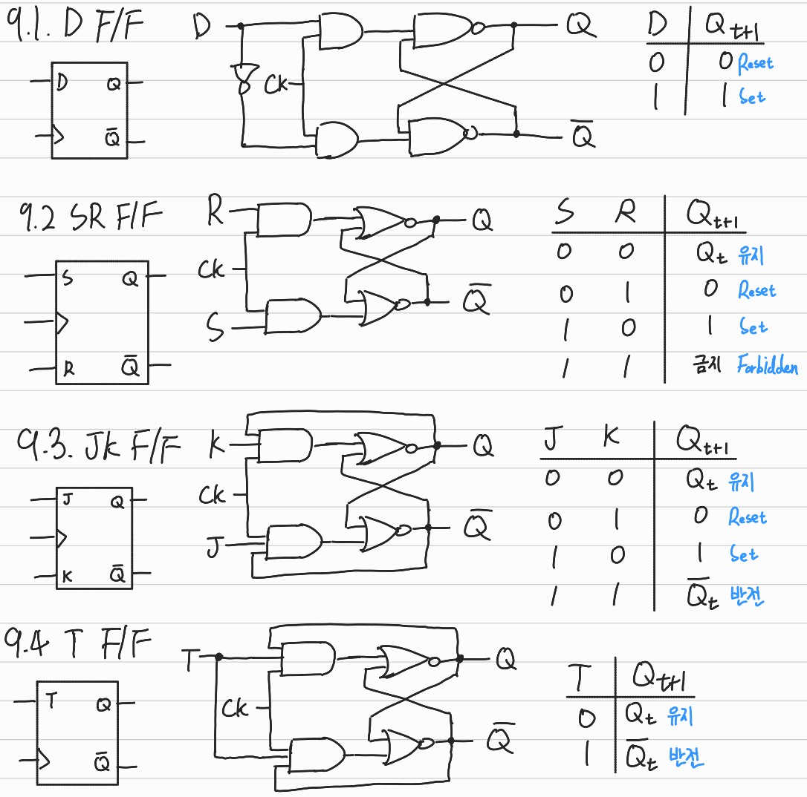

# Flip-Flop (D / SR / JK / T)
Verilog HDL로 D, SR, JK, T Flip-Flop을 클럭 상승 에지 동작으로 설계했습니다.

Flip-Flop은 클럭 에지에서 입력을 샘플링해 1-bit 값을 저장하는 순차회로의 기본 소자입니다.

## 📁 Files
| File | Description | Modeling |
|---|---|---|
| `D_FF.v` | D Flip-Flop + Testbench | Behavioral |
| `SR_FF.v` | SR Flip-Flop + Testbench | Behavioral |
| `JK_FF.v` | JK Flip-Flop + Testbench | Behavioral |
| `T_FF.v` | T Flip-Flop + Testbench | Behavioral |

## 1. 동작 비교
| 종류 | 특성 방정식 | 동작 |
|---|---|---|
| D | `Q⁺ = D` | D를 그대로 저장 (0: Reset, 1: Set) |
| SR | `Q⁺ = S + R̄·Q` (S·R = 0) | Hold / Reset / Set, **S = R = 1은 금지** |
| JK | `Q⁺ = J·Q̄ + K̄·Q` | SR의 금지 상태를 Toggle로 대체 |
| T | `Q⁺ = T ⊕ Q` | T = 0: Hold, T = 1: Toggle |

### 진리표
**D**

| D | Q⁺ |
|:-:|:-:|
| 0 | 0 (Reset) |
| 1 | 1 (Set) |

**SR**

| S | R | Q⁺ |
|:-:|:-:|:-:|
| 0 | 0 | Q (유지) |
| 0 | 1 | 0 (Reset) |
| 1 | 0 | 1 (Set) |
| 1 | 1 | 금지 |

**JK**

| J | K | Q⁺ |
|:-:|:-:|:-:|
| 0 | 0 | Q (유지) |
| 0 | 1 | 0 (Reset) |
| 1 | 0 | 1 (Set) |
| 1 | 1 | Q̄ (반전) |

**T**

| T | Q⁺ |
|:-:|:-:|
| 0 | Q (유지) |
| 1 | Q̄ (반전) |



> 위 그림의 회로도는 클럭으로 게이팅한 NOR 래치 구조로 동작 원리를 보여주기 위한 개념도입니다. Verilog 모델은 클럭 **상승 에지**(`posedge CK`)에서 동작하도록 기술했습니다.

## 2. 구현
```verilog
always @(posedge CK) begin
    Q <= D;                      // D FF
end
```
```verilog
always @(posedge CK) begin
    case ({J, K})
        2'b00: Q <= Q;           // Hold
        2'b01: Q <= 0;           // Reset
        2'b10: Q <= 1;           // Set
        2'b11: Q <= ~Q;          // Toggle
    endcase
end
```
- SR은 `2'b11`에서 `Q <= 1'bx`로 금지 상태를 표현
- T는 Set/Reset 입력이 없어 `Q <= ~Q`만 반복하므로 **초기값(`initial Q = 0`)이 없으면 x가 유지됨**
- 모든 소자는 비차단 할당(`<=`) 사용

## ✅ Key Learning
- 래치(레벨 동작)와 Flip-Flop(에지 동작)의 차이
- 4가지 Flip-Flop의 특성 방정식과 상호 관계 (JK는 SR 확장, T는 J = K = T인 JK)
- 순차회로에서 비차단 할당(`<=`)을 쓰는 이유
- T Flip-Flop은 이후 4-bit Counter 설계에 사용

## 🛠 Development Environment
- Verilog HDL / Antigravity IDE (VS Code)