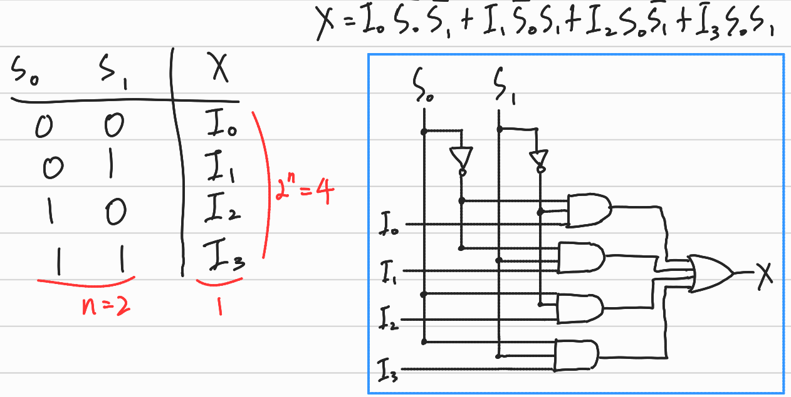
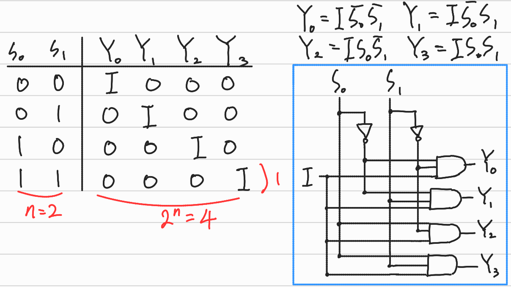

# MUX / DEMUX
Verilog HDL로 4-to-1 MUX와 1-to-4 DEMUX를 설계했습니다.

선택 신호(S0, S1)로 여러 입력 중 하나를 골라 출력(MUX)하거나, 하나의 입력을 여러 출력 중 하나로 분배(DEMUX)합니다.

## 📁 Files
| File | Description | Modeling |
|---|---|---|
| `MUX.v` | 4-to-1 MUX + Testbench | Dataflow |
| `DEMUX.v` | 1-to-4 DEMUX + Testbench | Dataflow |

## 1. MUX (4-to-1)
선택 신호 n = 2개로 2ⁿ = 4개의 입력 중 하나를 출력합니다.
(코드 포트 대응: `I0~I3 = IN0~IN3`, `X = OUT`, `S0`이 MSB)

| S0 | S1 | X |
|:-:|:-:|:-:|
| 0 | 0 | I0 |
| 0 | 1 | I1 |
| 1 | 0 | I2 |
| 1 | 1 | I3 |

- `X = I0·S̄0·S̄1 + I1·S̄0·S1 + I2·S0·S̄1 + I3·S0·S1`

## 2. DEMUX (1-to-4)
하나의 입력 I를 선택 신호에 따라 4개 출력 중 하나로 전달하고, 나머지 출력은 0입니다.
(코드 포트 대응: `I = IN`, `Y0~Y3 = OUT0~OUT3`, `S0`이 MSB)

| S0 | S1 | Y0 | Y1 | Y2 | Y3 |
|:-:|:-:|:-:|:-:|:-:|:-:|
| 0 | 0 | I | 0 | 0 | 0 |
| 0 | 1 | 0 | I | 0 | 0 |
| 1 | 0 | 0 | 0 | I | 0 |
| 1 | 1 | 0 | 0 | 0 | I |

- `Y0 = I·S̄0·S̄1`, `Y1 = I·S̄0·S1`
- `Y2 = I·S0·S̄1`, `Y3 = I·S0·S1`

DEMUX는 [Decoder](../Encoder_Decoder)의 각 출력에 입력 I를 AND한 것과 같고, I가 Enable 역할을 합니다.

## ✅ Key Learning
- 선택 신호 n개로 2ⁿ개를 제어하는 구조
- MUX = 최소항 선택 + OR, DEMUX = Decoder + Enable 라는 관계
- 데이터 경로 선택(MUX), 신호 분배(DEMUX)가 실제 RTL에서 어디에 쓰이는지 이해

## 🛠 Development Environment
- Verilog HDL / Antigravity IDE (VS Code)