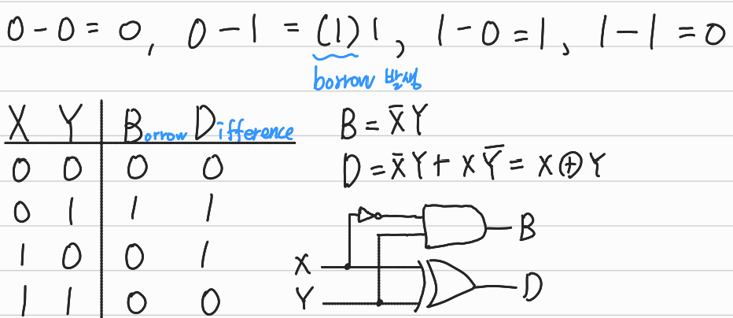
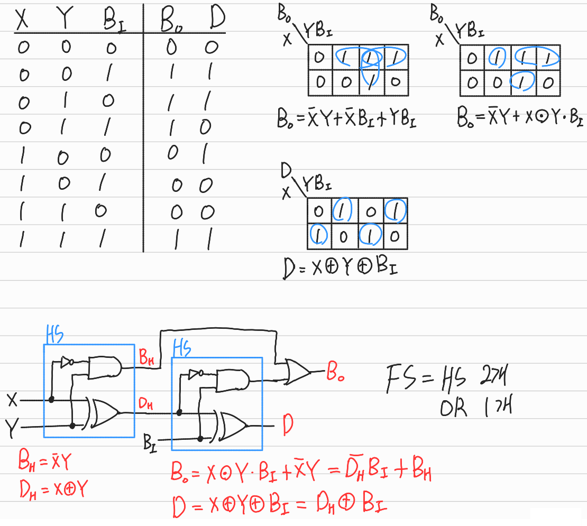

# Subtractor (Half Subtractor / Full Subtractor)
Verilog HDL로 Half Subtractor와 Full Subtractor를 설계하고, Full Subtractor를 서로 다른 두 방식으로 구현해 비교했습니다.

Adder와 동일한 흐름(진리표 → K-map → 논리식 → Verilog)으로 설계했으며, 가산기와의 구조적 차이를 함께 정리했습니다.

## 📁 Files
| File | Description | Modeling |
|---|---|---|
| `Half_Subtractor.v` | Half Subtractor + Testbench | Dataflow |
| `Full_Subtractor.v` | Full Subtractor + Testbench | Dataflow (논리식) |
| `Full_Subtractor_2HS.v` | Half Subtractor 2개 + OR로 구성한 Full Subtractor | Structural |

## 1. Half Subtractor
1-bit 두 수의 차(X − Y)를 Difference(D)와 Borrow(B)로 출력합니다. (0 − 1 = (1)1 → Borrow 발생)

| X | Y | B | D |
|:-:|:-:|:-:|:-:|
| 0 | 0 | 0 | 0 |
| 0 | 1 | 1 | 1 |
| 1 | 0 | 0 | 1 |
| 1 | 1 | 0 | 0 |

- `B = X̄ · Y`
- `D = X ⊕ Y`



## 2. Full Subtractor
Borrow-in(BI)까지 포함해 X − Y − BI를 계산합니다.

| X | Y | BI | BO | D |
|:-:|:-:|:-:|:-:|:-:|
| 0 | 0 | 0 | 0 | 0 |
| 0 | 0 | 1 | 1 | 1 |
| 0 | 1 | 0 | 1 | 1 |
| 0 | 1 | 1 | 1 | 0 |
| 1 | 0 | 0 | 0 | 1 |
| 1 | 0 | 1 | 0 | 0 |
| 1 | 1 | 0 | 0 | 0 |
| 1 | 1 | 1 | 1 | 1 |

K-map 간소화 결과:
- `BO = X̄Y + X̄·BI + Y·BI = X̄Y + (X ⊙ Y)·BI`
- `D = X ⊕ Y ⊕ BI`



### 구현 방식 비교
**(a) Dataflow** — `Full_Subtractor.v`
```verilog
assign BO = (~(X ^ Y) & BI) | (~X & Y);
assign D  = X ^ Y ^ BI;
```

**(b) Structural (HS 2개 + OR)** — `Full_Subtractor_2HS.v`

`FS = HS 2개 + OR 1개`

- HS1: `BH1 = X̄ · Y`, `DH = X ⊕ Y`
- HS2: `BH2 = D̄H · BI`, `D = DH ⊕ BI`
- `BO = BH1 | BH2`

두 방식은 논리적으로 동일하며, (b)는 하위 모듈을 재사용하는 계층 설계의 기초가 됩니다.

## 🔁 Adder와의 비교
| 구분 | Half | Full |
|---|---|---|
| Adder | `C = A·B`, `S = A ⊕ B` | `CO = AB + (A ⊕ B)·CI`, `S = A ⊕ B ⊕ CI` |
| Subtractor | `B = X̄·Y`, `D = X ⊕ Y` | `BO = X̄Y + (X ⊙ Y)·BI`, `D = X ⊕ Y ⊕ BI` |

- Sum/Difference 출력은 XOR 구조로 **동일**
- Carry/Borrow는 입력 X의 반전(X̄)이 들어가는 점만 다름
- Full 단계에서는 Carry의 `A ⊕ B` 대신 Borrow에서 `X ⊙ Y`(XNOR)를 사용

## ✅ Key Learning
- 진리표 → K-map → 논리식 → Verilog로 이어지는 설계 흐름
- `BO = X̄Y + (X ⊙ Y)·BI` 형태로 정리하면 HS 재사용이 가능함을 확인
- Adder와 Subtractor의 구조적 유사성 (Sum/Difference는 XOR, Carry/Borrow는 입력 반전 차이)
- Dataflow vs Structural 모델링 차이

## 🛠 Development Environment
- Verilog HDL / Antigravity IDE (VS Code)