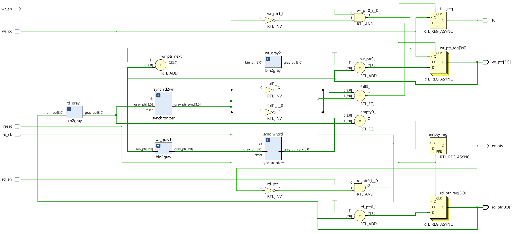
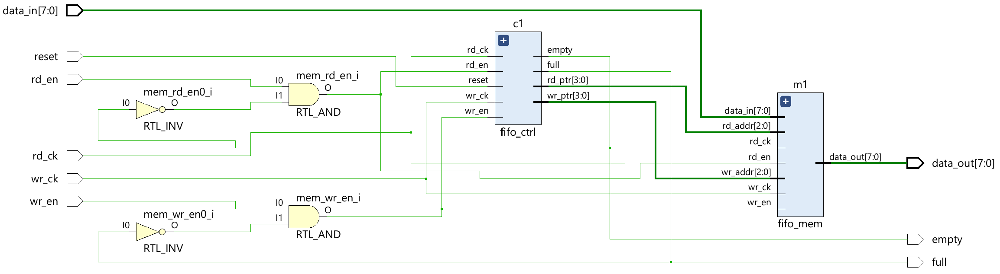
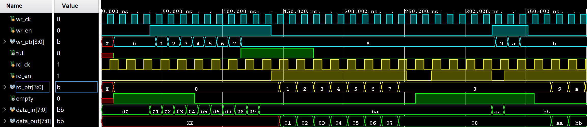

# Asynchronous First In First Out
Verilog HDL을 활용하여 Ascynchronous FIFO(비동기식 FIFO)를 설계한 프로젝트입니다.

Write Clock Domain과 Read Clock Domain을 분리하여 설계하였으며,
서로 다른 Clock 환경에서 데이터를 안정적으로 전달하기 위해
Gray Code 기반 Pointer Synchronization 방식을 적용하였습니다.

FIFO Controller와 Memory Block을 분리하여 설계하였으며,
Write Pointer와 Read Pointer를 Gray Code로 변환한 후
2-Flip Flop Synchronizer를 통해 CDC(Clock Domain Crossing)를 처리합니다.

## 🔀 Sync FIFO와 Async FIFO의 차이
동기식의 경우 Write와 Read가 같은 Clock을 사용한다.
따라서 CDC(Clock Domain Crossing) 문제가 없다.
반면에 비동기식의 경우 서로 다른 Clock을 사용한다.

신호가 한 클락 도메인에서 다른 클락 도메인으로 건너갈 때 적절한 동기화 과정이 없으면 Metastability 문제가 발생한다.

Binary Code의 경우 0111 → 1000 여기서 4bit가 동시에 바뀐다.
반면에 Gray Code의 경우 0100 → 1100 처럼 항상 1bit만 변경된다.
따라서 CDC에서 매우 안전하다.
```text
*CDC : 서로 다른  Clock으로 동작하는 Clock Domain끼리 데이터를 전송하는 과정
*Metastability : 서로 다른 클럭 영역 간에 신호가 전달될 때 수신 측 플립플롭이
 셋업/홀드 타임을 위반하여 출력이 '0'이나 '1'이 아닌 불안정한 중간 전압 상태에 빠지는 현상
*Binary Code Ex : 000 001 010 011 100 101 110 111
*Gray Code Ex : 000 001 011 010 110 111 101 100
```

## 📝 Module Hierarchy
```text
Asynchronous FIFO
├── Memory
├── Write Controller
│   ├── Binary to Gray
│   ├── 2-FF Synchronizer
│   └── Full Check
└── Read Controller
    ├── Binary to Gray
    ├── 2-FF Synchronizer
    └── Empty Check
```

## 📖 Schematic
### Controller


### Asynchronous FIFO


## 📈 Waveform


## 📈 Simulation
Asynchronous FIFO의 동작 검증을 위해 다음 5가지 Test Case를 수행하였습니다.

### Clock Setting
Write Clock : 10ns

Read Clock  : 14ns

## 1. Write Test
Write Clock에서 FIFO에 데이터를 순차적으로 저장하여 Write Pointer 증가 및 Memory 저장 동작을 검증합니다.

### Input Data
01 → 02 → 03 → 04 → 05 → 06 → 07 → 08

### Verification Point
- Write Enable 동작 확인
- Write Clock Domain 동작 확인
- Write Binary Pointer 정상 증가 확인
- Write Gray Pointer 변환 확인
- Memory 데이터 저장 확인

## 2. Overflow Test
FIFO Memory가 Full 상태가 되었을 때
추가 Write 요청이 정상적으로 차단되는지 검증합니다.

### Input Data
09 → 0A

### Expected Result
FIFO Memory → 01 02 03 04 05 06 07 08

09, 0A → Ignored

## Verification Point
- Full Flag 활성화 확인
- Write Pointer 유지 확인
- Full Detection Logic 검증
- Overflow 방지 동작 확인

## 3. Read Test
Read Clock을 기준으로 FIFO 내부 데이터를 순차적으로 출력하여
FIFO의 First In First Out 동작을 검증합니다.

### Output Data
01 → 02 → 03 → 04 → 05 → 06 → 07 → 08

### Verification Point
- Read Enable 동작 확인
- Read Clock Domain 동작 확인
- Read Pointer 정상 증가 확인
- 데이터 순서 유지 확인

## 4. Underflow Test
FIFO가 Empty 상태일 때
추가 Read 요청이 정상적으로 차단되는지 검증합니다.

## Expected Result
FIFO Memory → Empty

Read Request → Ignored

## Verification Point
- Empty Flag 활성화 확인
- Read Pointer 유지 확인
- Empty Detection Logic 검증
- Underflow 방지 동작 확인

## 5. Write + Read Test
서로 다른 Clock Domain에서 Write와 Read 동작을 동시에 수행하여  
비동기 FIFO의 동시 처리 능력과 데이터 전달 안정성을 검증합니다.

### Input Data
AA → BB

### Output Data
Previous Data → AA → BB

### Verification Point
- Read / Write 동시 동작 확인
- Read Pointer와 Write Pointer 독립 동작 확인
- 데이터 충돌 여부 확인
- FIFO 정상 동작 검증

## 🛠 Development Environment
- Language : Verilog HDL
- Editor : Antigravity IDE (VS Code)
- Tool : Vivado 2024.2
