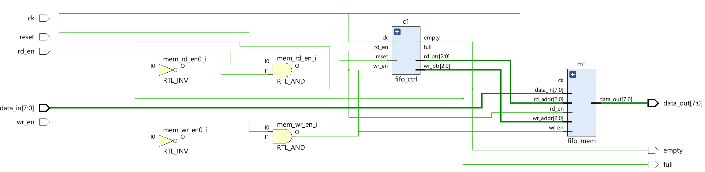
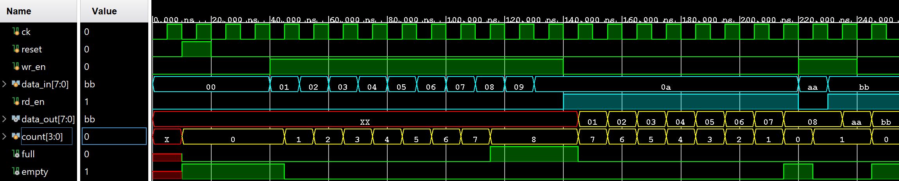

# Synchronous First In First Out
Verilog HDL을 활용하여 Scynchronous FIFO(동기식 FIFO)를 설계한 프로젝트입니다.

FIFO Controller와 Memory Block을 분리하여 설계하였으며,
Write Pointer와 Read Pointer를 기반으로 데이터 저장 및 출력을 관리합니다.

## 📝 Module Hierarchy
```text
Synchronous FIFO
├── Memory
└── Controller
```

## 📖 Schematic


## 📈 Waveform


## 📈 Simulation
Synchronous FIFO의 동작 검증을 위해 다음 4가지 Test Case를 수행하였습니다.

## 1. Write Test
FIFO에 8개의 데이터를 순차적으로 저장하여  
Write Pointer 증가 및 Memory 저장 동작을 검증합니다.

### Input Data
01 → 02 → 03 → 04 → 05 → 06 → 07 → 08

### Verification Point
- Write Enable 동작 확인
- Write Pointer 정상 증가 확인
- Memory 데이터 저장 확인
- Full Flag 활성화 확인

## 2. Overflow Test
FIFO가 Full 상태일 때 추가 Write 요청을 인가하여  
Overflow 상황에서 데이터가 정상적으로 무시되는지 검증합니다.

### Input Data
09 → 0A

### Expected Result
FIFO Memory → 01 02 03 04 05 06 07 08

09, 0A → Ignored

### Verification Point
- Full Flag 활성화 상태 확인
- Write Pointer 유지 확인
- 기존 Memory Data 유지 확인
- Overflow 방지 동작 검증

## 3. Read Test
FIFO에 저장된 데이터를 순차적으로 Read하여  
FIFO의 First In First Out 동작을 검증합니다.

### Output Data
01 → 02 → 03 → 04 → 05 → 06 → 07 → 08

### Verification Point
- Read Enable 동작 확인
- Read Pointer 정상 증가 확인
- 데이터 순서 유지 확인
- Empty Flag 활성화 확인

## 4. Write + Read Test
FIFO 내부에 데이터가 존재하는 상태에서  
동시에 Write와 Read 동작을 수행하여 정상적인 Throughput을 검증합니다.

### Input Data
AA → BB

### Output Data
Previous Data → AA → BB

### Verification Point
- Read / Write 동시 동작 확인
- Read Pointer와 Write Pointer 독립 동작 확인
- 데이터 충돌 여부 확인
- FIFO 정상 동작 검증

## 🛠 Development Environment
- Language : Verilog HDL
- Editor : Antigravity IDE (VS Code)
- Tool : Vivado 2024.2
